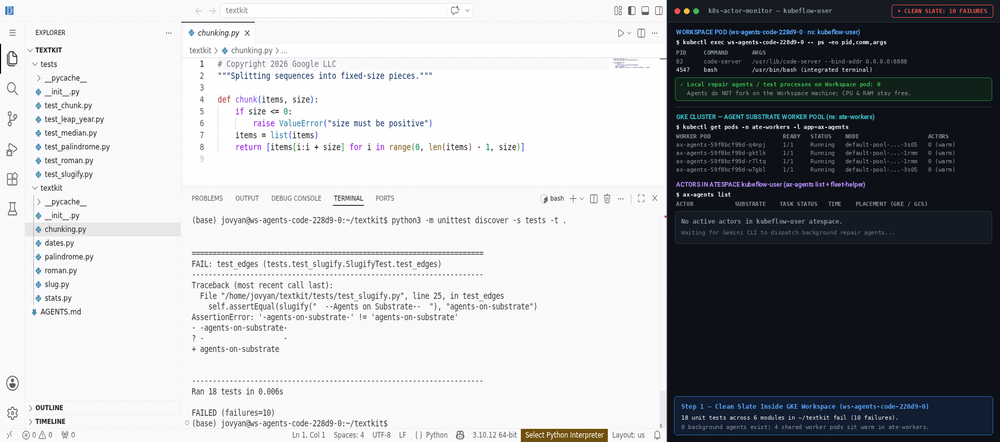
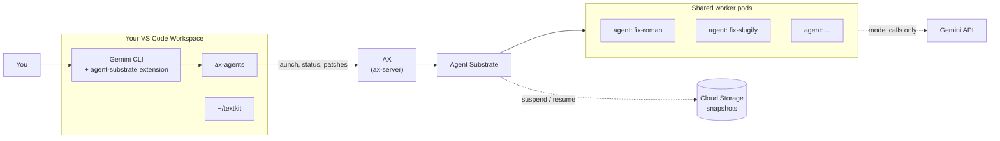
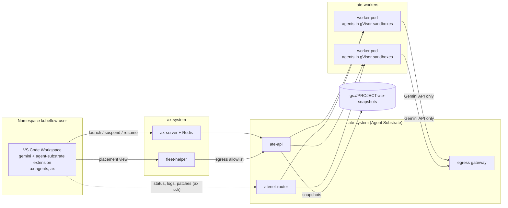

# Agent Substrate: Background Coding Agents for Your Workspace

Ask Gemini CLI in your VS Code Workspace to hand coding work to a team of
**background agents**. Each agent gets its own copy of your project and works in
an isolated sandbox on the cluster, in parallel with the others. When it is done
you review its patch and merge it. Agents keep working when you close the
browser, cost nothing but a snapshot while they are suspended, and wake up in
seconds with their files intact.



**Quick start** (after the [one-time platform setup](../README.md#start-here-one-time-setup-the-order-things-have-to-happen-in), on a [GKE ≥ 1.37 Standard cluster](#prerequisites)):

1. From the repository root: `./examples/agent-substrate/deploy_agent_substrate.sh`
2. Create a `codeserver` Workspace with the image **Code Server + AX agents (CPU)**.
3. Open a terminal, run `gemini`, and ask:
   *"The tests in ~/textkit fail. Send one background agent per failing test
   module to fix them, then merge the fixes."*

The rest of this page explains each step.

> [!WARNING]
> **Demo-grade security.** The agent control plane (AX's `ax-server`) has no
> authentication, so anyone who can run code in the tenant namespace can manage
> that namespace's agents. Agent Substrate itself is only reachable from AX. Do
> not use this on a cluster shared with untrusted users. See
> [Security model](#security-model).

---

## Table of Contents

- [What this example does](#what-this-example-does)
- [Prerequisites](#prerequisites)
- [Step 1: Deploy Agent Substrate and AX](#step-1-deploy-agent-substrate-and-ax)
- [Step 2: Start a VS Code Workspace](#step-2-start-a-vs-code-workspace)
- [Step 3: Hand work to background agents](#step-3-hand-work-to-background-agents)
- [Use it on your own code](#use-it-on-your-own-code)
- [Without Gemini: the `ax-agents` CLI](#without-gemini-the-ax-agents-cli)
- [How it works](#how-it-works)
- [Configuration](#configuration)
- [Security model](#security-model)
- [Cost](#cost)
- [Troubleshooting](#troubleshooting)
- [Cleanup](#cleanup)
- [Reference](#reference)

---

## What this example does

A coding assistant in a terminal is good at one thing at a time, in your
session, with your credentials. This example gives it **helpers that run
somewhere else**:

| You ask Gemini to... | What happens |
| :--- | :--- |
| "fix these six failing tests, one agent each" | Six agents start in seconds, each with its own copy of the project, in its own gVisor sandbox. They share a few warm worker pods instead of getting one pod each. |
| "how are the agents doing?" | Gemini shows each agent's state, whether its check passed, and which worker pod it is packed onto. |
| "show me what fix-roman changed" | You get the agent's patch and its own summary of the change. |
| "merge the fixes that pass and run the tests" | The patches are applied to your project in the Workspace, and the full suite runs. |
| "suspend everything, I'll continue tomorrow" | Every agent is snapshotted to Cloud Storage and stops using CPU and memory. Resuming one takes about a second, on any free worker, with its files intact. |

Nothing in this conversation is AX- or Substrate-specific: Gemini learns how to
drive the agents from an **extension** that comes with the Workspace image (a
skill, plus `/agents:*` slash commands). The technical details live in that
skill, not in your prompts.

The Workspace ships with **`~/textkit`**, a tiny Python library with six bugs,
each caught by a failing test module, so you can try it right away.



> [!NOTE]
> **How this differs from [`agent-sandbox`](../agent-sandbox/):** there, Gemini
> runs code in throwaway sandbox *pods* that it drives step by step over MCP.
> Here, Gemini hands whole tasks to *autonomous agents* that run on their own.
> Many agents share one worker pod, and a suspended agent can be picked up
> again hours later with its work intact.

---

## Prerequisites

1. **A GKE Standard cluster on 1.37 or newer** (or 1.36 created with the
   pod-certificate beta APIs). Agent Substrate issues short-lived certificates
   through the `PodCertificateRequest` and `ClusterTrustBundle` APIs, and its node
   agent needs a Standard cluster. Autopilot is not supported.

   <details>
   <summary><b>Creating a suitable cluster</b></summary>

   Use the command from [examples step 1](../README.md#1-authenticate-set-environment-variables--create-a-gke-cluster)
   and add **one** of:

   ```bash
   # Option A: GKE 1.37 or newer
   #   (check your channel: gcloud container get-server-config --location "${LOCATION}")
     --cluster-version=1.37 \

   # Option B: GKE 1.36, with the beta APIs enabled at creation (cannot be added later)
     --cluster-version=1.36 \
     --enable-kubernetes-unstable-apis=certificates.k8s.io/v1beta1/podcertificaterequests,certificates.k8s.io/v1beta1/clustertrustbundles \
   ```

   Check: `kubectl api-resources --api-group=certificates.k8s.io | grep -E 'clustertrustbundles|podcertificaterequests'`
   prints two lines.
   </details>

2. **The platform is deployed**: steps 1–3 of the
   [Examples README](../README.md#start-here-one-time-setup-the-order-things-have-to-happen-in)
   (`providers/gke/deploy_standalone.sh`). That creates the tenant namespace, the
   Artifact Registry repository and the `codeserver` WorkspaceKind.
3. **A Gemini API key** from [Google AI Studio](https://aistudio.google.com/apikey),
   stored in the tenant namespace. Both the agents and Gemini CLI in the
   Workspace use it:

   ```bash
   kubectl -n "${TENANT_NAMESPACE}" create secret generic gemini-api-key \
     --from-literal=GEMINI_API_KEY="your-gemini-api-key"
   ```

   > [!IMPORTANT]
   > Every `codeserver` and `jupyterlab` Workspace in the namespace receives this
   > key as `GEMINI_API_KEY`. Only create it if you want to share one key across
   > the namespace.

4. **Tools on the machine that runs the deploy script:** `gcloud`, `kubectl`,
   `git`, `go` (any recent version; `GOTOOLCHAIN=auto` fetches the one needed),
   `envsubst`, `python3`, and **Docker** (or `USE_CLOUD_BUILD=true`). `ko` is
   installed automatically if missing.

---

## Step 1: Deploy Agent Substrate and AX

Export the same values you used for `deploy_standalone.sh`, then run the deploy
script from the repository root (about 20 minutes):

```bash
export PROJECT_ID="your-gcp-project-id"
export CLUSTER_NAME="kubeflow-notebooks"
export LOCATION="us-west1"   REGION="us-west1"
export TENANT_NAMESPACE="kubeflow-user"
export REPO_NAME="kubeflow-repo"

./examples/agent-substrate/deploy_agent_substrate.sh
```

It installs everything the agents need. You don't need to understand these
pieces to use the example; [How it works](#how-it-works) explains them.

| # | Step | What it creates |
| :--- | :--- | :--- |
| 1 | Preflight | Checks tools, the certificate APIs, Workload Identity, Standard vs. Autopilot |
| 2 | Node pool | `substrate-pool` (2 × `c3-standard-4`, regular non-gVisor nodes) for the worker pods |
| 3 | Snapshot bucket | `gs://${PROJECT_ID}-ate-snapshots`, plus Workload Identity bindings for Substrate |
| 4 | Agent Substrate `v0.5.0` | The `ate-system` namespace |
| 5 | WorkerPool | 4 warm worker pods (2 CPU, 4 GiB each) that the agents are packed onto |
| 6 | AX + agent runtime | `ax-server` in `ax-system`, and the image every agent runs ([`agent-runtime/`](agent-runtime/)) |
| 7 | Workspace image | **Code Server + AX agents (CPU)** ([`images/codeserver-ax/`](../../images/codeserver-ax/Dockerfile)), added as an image option to the `codeserver` WorkspaceKind, which also gets the optional `GEMINI_API_KEY` |
| 8 | Tenant access | [`fleet-helper`](fleet-helper/main.go) (network allowlist for agents, worker placement view), [NetworkPolicies and RBAC](manifests/ax-access.yaml) |
| 9 | Smoke test | One agent sandbox: create, resume, run a command, delete |

Expected output (abridged):

```
==> 6/9 AX (bump): agent runtime image, ax-server, ax CLI
Agent runtime:  us-west1-docker.pkg.dev/my-project/kubeflow-repo/ax-agent-runtime@sha256:...
deployment "ax-server" successfully rolled out
==> 7/9 Workspace image: Code Server + AX agents
WorkspaceKind codeserver: image option "Code Server + AX agents (CPU)" -> .../codeserver-ax:v2026...
==> 9/9 Smoke test
Smoke test passed: a task ran on Substrate and answered over ax ssh.
```

---

## Step 2: Start a VS Code Workspace

1. In the Kubeflow Workspaces UI, select your namespace and click **Create Workspace**.
2. Choose WorkspaceKind **`codeserver`**, image **Code Server + AX agents (CPU)**,
   and pod config **Small CPU**. That is plenty: the agents run on the shared
   worker pods, not in your Workspace.
3. When it is **Ready**, click **Connect** and open a terminal
   (**Terminal → New Terminal**).

The image comes with everything set up:

| | |
| :--- | :--- |
| `gemini` | Gemini CLI, signed in with the namespace's API key, with the **agent-substrate** extension: a skill that teaches it to use background agents, and the `/agents:status` and `/agents:fix-tests` commands. A policy in `~/.gemini/policies/` lets it run `ax-agents` without asking each time; deleting agents still asks |
| `ax-agents` | The command the extension uses to launch, watch, review and merge agents. You can use it directly too ([below](#without-gemini-the-ax-agents-cli)) |
| `~/textkit` | The sample project: six bugs, six failing test modules |

Check with `gemini extensions list`: it shows `agent-substrate` with the skill
`agent-substrate`.

---

## Step 3: Hand work to background agents

Start Gemini CLI in the terminal:

```bash
gemini
```

Then just talk to it. A typical session:

**1. Fan out.**

> The tests in ~/textkit fail. Send one background agent per failing test module
> to fix them.

Gemini runs the suite, finds six failing modules, and launches six agents, each
with its own copy of `~/textkit`, a short task, and that module's tests as its
check:

```
Sent 15 files from /home/jovyan/textkit (6 agent(s)); starting them...
  fix-chunk                started
  fix-leap-year            started
  ...
```

The agents now work in the background. You can keep using Gemini, open other
files, or close the browser.

**2. Check on them.** Ask *"How are the agents doing?"*, or type `/agents:status`:

```
AGENT           STATE    CHECK  FILES  TIME   WORKER
fix-chunk       done     pass   1      1m27s  fv2kw
fix-leap-year   done     pass   1      1m12s  p6h9z
fix-median      done     pass   1      1m06s  sgvhl
fix-palindrome  working                1m30s  wrdgs
fix-roman       done     pass   1      1m04s  fv2kw
fix-slugify     done     pass   1      0m55s  p6h9z

6 running agent(s) share 4 worker pod(s); 0 suspended or stopped.
```

Agents usually finish in one to five minutes.

**3. Review.**

> Show me what fix-roman changed, and why.

Gemini shows the patch and the agent's own summary:

```diff
--- a/textkit/roman.py
+++ b/textkit/roman.py
@@ -8,7 +8,7 @@ def roman_to_int(numeral):
     for ch in reversed(numeral.upper()):
         value = VALUES[ch]
-        if value > prev:
+        if value < prev:
             total -= value
```

**4. Merge.**

> Merge the fixes that passed and run the full test suite.

The patches are applied to `~/textkit` in your Workspace, and the suite runs
there: `Ran 18 tests ... OK`.

**5. Pause and pick up later.**

> Suspend all the agents.

Each agent is snapshotted to Cloud Storage in about a second and stops using
CPU and memory. Later, even in a new Gemini session:

> Resume fix-palindrome and show me its log.

It is back in about a second, on whichever worker has room, with its files
exactly as it left them. If it was still working when you suspended it, it
carries on where it stopped.

**6. Clean up.**

> Delete the agents.

Gemini asks you to confirm before it deletes anything.

> [!TIP]
> `/agents:fix-tests ~/textkit` runs steps 1 to 4 in one go.

---

## Use it on your own code

Put your project in the Workspace (for example `git clone` it into your home
directory), start `gemini` in it, and describe the work. Some prompts to try:

- *"Split the TODOs in src/ between three background agents and merge what they produce."*
- *"Have an agent add type hints to every module under utils/ while I work on the API."*
- *"Launch two agents with different approaches to speeding up parse(); compare their patches."*

Keep in mind:

- **The agents only see the directory you send** (text files only, up to 3 MiB,
  without `.git`, virtualenvs or `node_modules`). For a large repository, point
  them at the part that matters.
- **The sandboxes have no internet access apart from the Gemini API**: no
  `pip install`, no downloads, no `git clone`. Tasks that need only the project
  and what is installed (Python 3.12, git, a shell) work best.
- **Give them a check.** A test command per agent lets you see at a glance which
  patches are ready to merge. Gemini adds one when your project has tests.

---

## Without Gemini: the `ax-agents` CLI

Everything Gemini does goes through `ax-agents`, which you can also use directly
in the terminal:

```bash
ax-agents launch --dir ~/textkit \
  --check "python3 -m unittest -q tests.test_roman" \
  --agent fix-roman "Fix the bug that makes tests/test_roman.py fail. Change only library code."

ax-agents list                 # every agent's state, check result and worker pod
ax-agents wait                 # block until they finish
ax-agents logs fix-roman       # what it did, and its summary
ax-agents diff fix-roman       # its patch (--stat for just the files)
ax-agents apply fix-roman      # apply the patch to ~/textkit
ax-agents suspend --all        # snapshot every agent to Cloud Storage
ax-agents resume fix-roman     # back in about a second
ax-agents sh fix-roman -- ls   # run a command inside the agent's sandbox
ax-agents delete --all
```

To launch agents that need different checks in one go, pass
`--agents-file -` with a JSON list of `{"name", "task", "check"}` objects on
stdin. `ax-agents --help` and `ax-agents <command> --help` list every option.

---

## How it works

You don't need this section to use the example. It describes what the deploy
script installs and what happens when an agent runs.



| Piece | Role |
| :--- | :--- |
| **Workspace image** ([`images/codeserver-ax`](../../images/codeserver-ax/Dockerfile)) | Gemini CLI with the [`agent-substrate` extension](gemini-extension/), whose [skill](gemini-extension/skills/agent-substrate/SKILL.md) holds the workflow and the technical details; [`ax-agents`](gemini-extension/skills/agent-substrate/scripts/ax-agents), a small Python CLI over AX's `ax` CLI |
| **[AX](https://github.com/google/ax)** (`ax-server`) | Declarative agent API. Each agent is an AX `Task`; the uploaded project is an AX `Workspace` |
| **Agent runtime** ([`agent-runtime/`](agent-runtime/)) | The image every agent runs: AX's `ax-task-runner` plus [`ax-coding-agent`](agent-runtime/ax-coding-agent), which runs a Gemini-powered [Antigravity](https://pypi.org/project/google-antigravity/) agent on the task, then the check, and records status, activity and a patch |
| **[Agent Substrate](https://github.com/agent-substrate/substrate)** (`ate-system`) | Runs each agent as an *actor* in a gVisor sandbox inside a shared worker pod, snapshots it to Cloud Storage on suspend, and restores it onto any free worker on resume |
| **[`fleet-helper`](fleet-helper/main.go)** | Gives new agents a network allowlist (Substrate denies all agent egress until one exists; here, only the Gemini API), and serves the worker placement that `ax-agents list` shows |

**The life of one agent:**

1. `ax-agents launch` uploads the project's text files as an AX `Workspace` and
   creates one AX `Task` per agent, with the task text and check in its
   environment. Then it resumes the tasks.
2. Substrate restores each agent from a pre-made ("golden") snapshot onto a worker
   pod with room. No pod is scheduled, so this takes seconds.
3. Inside the sandbox, `ax-coding-agent` copies the project into
   `/workspace/work/`, commits the original files to a local Git repository, and
   runs the coding agent. It logs each tool call to `/workspace/.agent/activity.log`,
   then runs the check and writes `status.json`.
4. `ax-agents list`, `logs` and `diff` read those files over `ax ssh`. `diff` is
   `git diff` against the original files.
5. On suspend, Substrate saves `/workspace` (not the processes) to Cloud Storage.
   On resume, `ax-coding-agent` finds its status file: a finished agent stays
   finished, and an interrupted one continues from the files on disk.

---

## Configuration

Environment variables read by [`deploy_agent_substrate.sh`](deploy_agent_substrate.sh).
Pinned versions live in [`versions.env`](versions.env).

| Variable | Default | Meaning |
| :--- | :--- | :--- |
| `PROJECT_ID`, `CLUSTER_NAME`, `LOCATION`, `REGION`, `TENANT_NAMESPACE`, `REPO_NAME` | as in `deploy_standalone.sh` | Must match the platform deployment |
| `GEMINI_API_KEY` | the tenant's `gemini-api-key` Secret | Key the agents use (stored as Secret `ax-system/gemini-api-secret`) |
| `SUBSTRATE_VERSION` | `v0.5.0` | Agent Substrate release |
| `AX_REPO` / `AX_REF` | `siyuanfoundation/ax` / `bump` | AX source (this branch tracks Substrate v0.5.0) |
| `ATE_SNAPSHOT_BUCKET` | `${PROJECT_ID}-ate-snapshots` | Where agent snapshots go |
| `SUBSTRATE_NODE_POOL` / `SUBSTRATE_MACHINE_TYPE` / `SUBSTRATE_NODES` | `substrate-pool` / `c3-standard-4` / `2` | Node pool for the worker pods (`CREATE_NODE_POOL=false` to use an existing non-gVisor pool) |
| `WORKER_REPLICAS` / `WORKER_CPU` / `WORKER_MEMORY` | `4` / `2` / `4Gi` | Worker pods, and the capacity of each that agents are packed into |
| `EGRESS_HOSTNAMES` | `["generativelanguage.googleapis.com"]` | Hosts every agent may reach (TLS passthrough, port 443) |
| `USE_CLOUD_BUILD` | `false` | Build images with Cloud Build instead of local Docker |
| `BUILD_WORKSPACE_IMAGE` | `true` | Build the Code Server + AX agents image and register it |
| `WORKSPACE_KINDS` | `codeserver` | WorkspaceKinds that get the image option |
| `SMOKE_TEST` | `true` | Run the end-to-end smoke task |
| `WORK_DIR` | `~/.cache/gke-workspaces/agent-substrate` | Source checkouts and built binaries |

`ax-agents launch` options: `--timeout` (default `30m`), `--cpu` (default `1`)
and `--memory` (default `2Gi`) per agent.

---

## Security model

| Boundary | How it's enforced |
| :--- | :--- |
| You → Workspace | Unchanged: IAP and Kubernetes RBAC through `gke-access-proxy` |
| Agent code | A gVisor sandbox inside the worker pod, with no cluster credentials and **default-deny egress**: fleet-helper allows only `EGRESS_HOSTNAMES` (the Gemini API) |
| Workspace → Substrate API | **Blocked.** Substrate admits API clients only from namespaces labeled `ate.dev/api-access=true`, which is `ax-system`, not the tenant namespace |
| Workspace → AX | Allowed from the tenant namespace only ([`ax-access.yaml`](manifests/ax-access.yaml)). `ax-server` has **no authentication**: any pod in the namespace can manage any atespace through it |
| `ax ssh` | Worker pods accept traffic only from `atenet-router`, so `ax ssh` port-forwards to it. Tenant service accounts may port-forward to `ate-system` pods (other components still require their own mTLS or tokens) |
| Gemini key | AX puts it into each agent's environment, so it can end up in snapshots. A production setup would use Substrate's egress credential injection to keep it out of the sandbox |

Before production use you would need at least Substrate authorization
(`--experimental-enable-authz` with per-atespace AccessPolicies),
authentication in front of `ax-server`, per-tenant atespace pinning, and
credential injection for model keys.

---

## Cost

| Resource | Default | Notes |
| :--- | :--- | :--- |
| `substrate-pool` | 2 × `c3-standard-4` | Runs the worker pods and some Substrate components; most of the bill |
| Substrate control plane | Postgres + about 6 small Deployments | Fits on existing nodes |
| `gs://…-ate-snapshots` | A few MB per agent | One golden snapshot per agent, plus one per suspend |
| Gemini API | per token | Each agent makes a few dozen model calls for a small fix |
| Your Workspace | Small CPU | The agents' CPU comes from the worker pods |

Scale the pool to zero between sessions
(`gcloud container clusters resize "${CLUSTER_NAME}" --node-pool substrate-pool --num-nodes 0`),
or run [Cleanup](#cleanup).

---

## Troubleshooting

| Symptom | Fix |
| :--- | :--- |
| Deploy stops at "does not serve clustertrustbundles" | The cluster is older than 1.37, or a 1.36 cluster created without the beta APIs. Recreate it ([Prerequisites](#prerequisites)). |
| The image "Code Server + AX agents (CPU)" is missing from the form | `deploy_standalone.sh` was re-run after this example and reset the WorkspaceKind. Re-run `deploy_agent_substrate.sh`. |
| An existing Workspace still has the old image after re-running the deploy script | Each build gets its own image option (the Workspaces API does not allow changing an image that is in use). The old option is hidden and redirects to the new one, which the Workspace picks up on its next restart. Files already in your home directory (such as `~/.gemini/settings.json`) are not overwritten. |
| Gemini says it has no `agent-substrate` skill, or `ax-agents: command not found` | The Workspace does not use the Code Server + AX agents image. Create a new one with it. |
| `gemini` asks you to sign in | The namespace has no `gemini-api-key` Secret ([Prerequisites](#prerequisites)), or the Workspace started before it existed: restart the Workspace. Or `export GEMINI_API_KEY=...` in the terminal. |
| An agent's state is `failed` with `GEMINI_API_KEY is not set in the sandbox` | The deploy script found no key. Create the Secret and re-run the script. |
| `launch` or `resume` fails with `ActorResumeFailed` … `DENIED: Permission 'artifactregistry.repositories.downloadArtifacts'` | Substrate cannot pull the agent image. Re-run the deploy script, which grants `ate-system/atelet` read access to the repository. |
| `launch` or `resume` fails with another `ActorResumeFailed` | No room on the workers, or a platform problem. `kubectl -n ate-workers get pods` (are the workers Ready?) and `kubectl -n ax-system logs deploy/ax-server`. Raise `WORKER_REPLICAS` for more capacity. |
| An agent stays `working` for a long time | `ax-agents logs NAME` shows what it is doing. It stops after `--timeout` (30 minutes by default). |
| `ax ssh` / `list` shows `unknown` with a port-forward error | The Workspace's service account lacks the port-forward RBAC: `kubectl auth can-i create pods/portforward -n ate-system --as=system:serviceaccount:${TENANT_NAMESPACE}:ws-<name>`. Re-run the deploy script. |
| The agent cannot install a package or reach a site | Expected: the sandboxes may reach only the Gemini API. Add hosts with `EGRESS_HOSTNAMES` and re-run the deploy script; this applies to new agents. |

---

## Cleanup

In the Workspace, `ax-agents delete --all` removes your agents. To remove
everything the deploy script installed:

```bash
./examples/agent-substrate/cleanup_agent_substrate.sh
# also delete the node pool and the snapshot bucket:
DELETE_NODE_POOL=true DELETE_SNAPSHOT_BUCKET=true ./examples/agent-substrate/cleanup_agent_substrate.sh
```

The platform and your Workspaces are untouched. The optional `GEMINI_API_KEY`
setting stays on the `codeserver` WorkspaceKind, as on `jupyterlab`.

---

## Reference

### Files in this directory

| File | Purpose |
| :--- | :--- |
| [`gemini-extension/`](gemini-extension/) | The Gemini CLI extension baked into the Workspace image: [`GEMINI.md`](gemini-extension/GEMINI.md) (always-on context), the [`agent-substrate` skill](gemini-extension/skills/agent-substrate/SKILL.md) with the [`ax-agents`](gemini-extension/skills/agent-substrate/scripts/ax-agents) CLI, and the [`/agents:*` commands](gemini-extension/commands/agents/) |
| [`agent-runtime/`](agent-runtime/) | The agents' image: AX's `ax-task-runner` plus [`ax-coding-agent`](agent-runtime/ax-coding-agent) |
| [`textkit/`](textkit/) | The sample project (six bugs), seeded into `~/textkit` |
| [`deploy_agent_substrate.sh`](deploy_agent_substrate.sh) / [`cleanup_agent_substrate.sh`](cleanup_agent_substrate.sh) | Install and remove everything above the platform |
| [`fleet-helper/`](fleet-helper/) | Go source of the egress defaulter and placement view (built with `ko`) |
| [`manifests/`](manifests/) | `SubstrateInstall` config, `WorkerPool`, fleet-helper, tenant NetworkPolicies and RBAC |
| [`register_workspace_image.py`](register_workspace_image.py) | Adds the image option (one per build; older ones are hidden and redirect to it) and the optional `GEMINI_API_KEY` to the `codeserver` WorkspaceKind, or removes the options |
| [`versions.env`](versions.env) | Pinned Substrate and AX versions (also read by `images/build.sh --codeserver-ax`) |
| [`../../images/codeserver-ax/`](../../images/codeserver-ax/Dockerfile) | The Workspace image |

### Glossary

| Term | Meaning |
| :--- | :--- |
| **Agent** | One background worker: an AX Task, running as a Substrate actor, with a coding agent inside |
| **Actor** | Substrate's unit of work: one sandboxed container that can be suspended to storage and resumed on any worker |
| **WorkerPool** | A Substrate resource: a set of warm worker pods that actors are packed onto |
| **Golden snapshot** | A snapshot Substrate takes once per agent template. New agents start from it instead of booting from scratch |
| **AX Task / Workspace** | AX resources. A `Task` is one agent; an AX `Workspace` is the files mounted into it. Not the same thing as a Kubeflow Workspace |
| **Atespace** | Substrate's namespace for actors; here, named after your Kubernetes namespace |
| **Skill / extension** | Gemini CLI features: an extension bundles context, skills and commands; a skill is a set of instructions (and scripts) Gemini loads when a task calls for it |

### Notes for maintainers

Two behaviors of AX (`bump` branch) shape the agent runtime:

- **A workspace `goal` cannot hold the real work.** AX runs the goal while the
  task reports not-ready, and Substrate gives a resuming actor only 30 seconds to
  become ready, so the first resume fails. `ax-coding-agent` therefore runs as
  the task's *command*.
- **Workspace files are written again on every resume.** `ax-task-runner`
  records "workspace prepared" in `/ax`, which is not on the durable volume. The
  agent therefore works on its own copy in `/workspace/work/`.

### See also

- [`agent-sandbox`](../agent-sandbox/): Gemini driving throwaway sandbox pods over MCP
- [`resumable-notebooks`](../resumable-notebooks/): pausing the Workspace itself with GKE Pod Snapshots
- Agent Substrate: [docs](https://github.com/agent-substrate/substrate/tree/main/docs), [egress traffic](https://github.com/agent-substrate/substrate/blob/main/docs/egress-traffic.md)
- AX: [concepts](https://github.com/google/ax/blob/main/docs/concepts.md), [runners](https://github.com/google/ax/blob/main/docs/runner.md)
- Gemini CLI: [extensions](https://github.com/google-gemini/gemini-cli/blob/main/docs/extensions/index.md)
