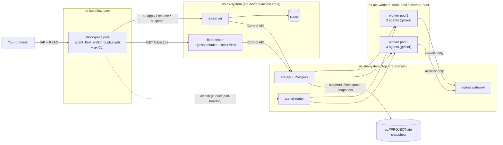

# Coding-agent fleets on Agent Substrate, driven from a Workspace


From one JupyterLab notebook, send a **fleet of coding agents**. Each agent fixes one bug in parallel. They run on [Agent Substrate](https://github.com/agent-substrate/substrate), which **packs several agents onto each warm worker pod**, **suspends idle agents to Cloud Storage**, and **resumes them on any free worker in seconds**. [AX](https://github.com/google/ax) gives each agent a declarative `Task` and an `ax` CLI. The Kubeflow Workspace is where you dispatch the agents, watch them, inspect their work, and merge the results.

**Quick start** (after the [one-time platform setup](../README.md#start-here-one-time-setup-the-order-things-have-to-happen-in) on a [cluster that meets the version requirement](#1-a-cluster-that-can-run-agent-substrate)):

1. `./examples/agent-substrate/deploy_agent_substrate.sh` from your workstation (about 20 min).
2. Create a `jupyterlab` Workspace with the image **"JupyterLab + AX agents (CPU)"**.
3. Open `~/agent-substrate/agent_fleet_walkthrough.ipynb` and run it. Nothing to install or upload.

> [!WARNING]
> **Demo-grade security.** Agent Substrate `v0.5.0` has **no authorization** in its control API (an experimental flag exists but is off): any client that can authenticate can manage every agent. AX's `ax-server` has **no authentication** at all. This example contains that with network policy: Workspaces can reach `ax-server` but not the Substrate API. That is a demo boundary, not a multi-tenant security model. See [Security model](#security-model). Do not run this on a cluster shared with untrusted users.

## Contents

- [What this example does](#what-this-example-does)
  - [Why do this in the cluster instead of on your laptop?](#why-do-this-in-the-cluster-instead-of-on-your-laptop)
- [How it fits together](#how-it-fits-together)
- [Prerequisites](#prerequisites)
- [Step-by-step](#step-by-step)
- [Configuration](#configuration)
- [Security model](#security-model)
- [Cost](#cost)
- [Troubleshooting](#troubleshooting)
- [Cleanup](#cleanup)
- [Reference](#reference)

---

## What this example does

The [`project/`](project/) directory holds `textkit`, a tiny Python library with **six bugs**, each caught by one failing test module. The notebook:

1. **Dispatches one agent per bug** (`fix-chunk`, `fix-roman`, …) with `ax apply`. The project files travel inside the AX manifest, so agents need no Git access.
2. **Resumes the fleet.** Substrate restores each agent from a golden snapshot onto a free worker. No Pod is scheduled.
3. **Shows the packing**: six agents on **two** worker pods.
4. **Polls a live leaderboard** over `ax ssh`. An agent counts as `fixed` only if its tests pass *and* it left the tests alone.
5. **Suspends the whole fleet** to GCS, then resumes one agent and proves that `/workspace` survived and `/tmp` didn't.
6. **Merges the winning patches** into a copy of the project inside the Workspace and runs the full suite.

There are two agent modes:

| Mode | Who fixes the bugs | Result |
| :--- | :--- | :--- |
| `scripted` (default) | A deterministic search-based repair bot ([`repair_bot.py`](project/tools/repair_bot.py)) that tries candidate mutations until the tests pass. No LLM, no egress. | 6 of 6 fixed: `chunk`, `roman`, `median`, `leap-year`, `slugify`, `palindrome`. |
| `gemini` | An Antigravity agent (Gemini). AX hands it the bug as the Task's workspace **goal**. | Typically 6 of 6. Needs `GEMINI_API_KEY` at deploy time. |

> [!NOTE]
> **How this differs from [`agent-sandbox`](../agent-sandbox/):** there, every sandbox is its own Pod, created from a warm pool and deleted when done. Here, sandboxes are Substrate **actors**. Many share a worker pod, and an idle one costs only its snapshot in GCS. It can be resumed later with its files intact, on any worker.

### Why do this in the cluster instead of on your laptop?

Two separate questions are easy to mix up here. Where do the **agents** run? And where do you **drive them from**? In this example the agents never run inside the Workspace. They run on Substrate worker pods, and the Workspace is only the place you send and watch them from.

**1. Agents on Substrate vs. agents on your laptop.** This is where most of the benefit is.

| | Coding agents on your laptop (e.g. Gemini CLI in a terminal) | Coding agents as Substrate actors (this example) |
| :--- | :--- | :--- |
| **Blast radius** | The agent runs as *you*: it can read your files, SSH keys, cloud credentials and browser cookies, and reach any network you can. | Each agent is in its own gVisor sandbox with no ambient credentials and **default-deny egress** (here: only the Gemini API, or nothing in `scripted` mode). A confused or prompt-injected agent can only damage its own `/workspace`. |
| **Parallelism** | Limited by your laptop's CPU and RAM. Agents share one checkout unless you set up worktrees by hand. | Six (or sixty) agents, each with its own copy of the project, packed onto shared worker pods. Add capacity by raising `WORKER_REPLICAS`. |
| **Long-running work** | Stops when the laptop sleeps, loses Wi-Fi, or you close the terminal. | Keeps running with the laptop closed. Finished or idle agents are **suspended to GCS** and can be resumed hours or days later with their files intact. |
| **Idle cost** | Nothing, but the agent's state is gone when the process ends. | A suspended agent costs only its snapshot in GCS, not a running Pod or VM. |

**2. Driving the fleet from a Workspace vs. from your laptop.** Here the benefit is smaller, and you can do either. The deploy script's smoke test drives AX from the workstation (`ax --context …`).

| | From your laptop | From a Workspace (this example) |
| :--- | :--- | :--- |
| **Footprint** | To keep agents running around the clock, people often dedicate an always-on machine, such as a Mac mini under the desk, sized for the *peak* number of agents. | The control point is small, because the agents' CPU and memory come from the shared worker pool, not from the Workspace. The notebook only runs the `ax` CLI, polls JSON, and draws a table, so the **Small CPU** option (1 CPU requested, 2–4 GiB) is plenty. Agent capacity is a separate setting (`WORKER_REPLICAS`) that you can scale up for a run and back to zero afterwards, and a paused Workspace uses no compute. |
| **Credentials** | Needs a kubeconfig for the cluster, plus RBAC to port-forward into `ax-system` and `ate-system` (the `ax` CLI tunnels through `kubectl port-forward`). | No cluster credentials on the laptop: browser → IAP → Workspace. The Workspace's namespace-scoped service account can reach `ax-server` and nothing else in AX/Substrate. This is the same access model as every other example. |
| **Session lifetime** | The notebook or polling loop dies with the laptop session. | The notebook keeps running in the cluster. With `jupyterlab-resumable`, even the kernel can be paused and resumed (GKE Pod Snapshots). |
| **Where results land** | Patches come back to the laptop. | Patches land next to the team's data and compute: the GCS bucket (via Workload Identity), Trainer, Ray and Spark are one call away for what comes next, e.g. training on the fixed code. |
| **Shared environment** | Each person installs `ax`, `kubectl` and Python on their own machine. | Everyone picks the same **JupyterLab + AX** image, which ships the `ax` build that matches the cluster's `ax-server`, plus `kubectl` and the walkthrough. The atespace is the namespace, so teammates in the namespace see the same fleet. |

**When your laptop is the better choice:** a single interactive agent pairing with you on code that only exists locally, where you want your own editor, tools and credentials, and don't need parallelism, isolation, or work that outlives your session. Also note that this demo ships the project inside the AX manifest to keep it self-contained. With a real repository you would point the AX `Workspace` at Git instead (`spec.git`), which needs egress and credentials for your Git host.

## How it fits together



| Piece | Role |
| :--- | :--- |
| **Workspace** (unchanged platform) | Where you work. It runs the notebook and the `ax` CLI. It reaches `ax-server` and `fleet-helper`, but **not** the Substrate API. |
| **AX** (`ax-server`, Redis, `ax-task-runner`) | Turns each `Task` into a Substrate actor. Each actor gets one durable `/workspace` volume (VOLUMES fidelity: files survive suspend, processes don't). |
| **Agent Substrate** (`ate-system`) | Control plane (ate-api + Postgres), node agent (atelet), router, and egress gateway. Agents run in gVisor sandboxes inside the `WorkerPool`'s pods. |
| **[`fleet-helper`](fleet-helper/main.go)** (about 300 lines of Go) | Fills two gaps for this demo. (1) Substrate denies all actor egress until the actor has an `EgressPolicy`, and AX doesn't create one, so fleet-helper gives new actors in the tenant's atespace a default policy. (2) It serves a read-only view of actor state and worker placement for the notebook. |

**Mapping between the two worlds:** the AX/Substrate **atespace** is named after the tenant **namespace** (`kubeflow-user`), so "my namespace's agents" means the same thing in both.

## Prerequisites

| | |
| :--- | :--- |
| Platform | Steps 1–3 of the [one-time setup](../README.md#start-here-one-time-setup-the-order-things-have-to-happen-in), including the GCS data bucket (step 2). The deploy script puts the `ax` CLI there. |
| Cluster | **GKE Standard** that serves the `PodCertificateRequest` and `ClusterTrustBundle` APIs. See [step 1](#1-a-cluster-that-can-run-agent-substrate). |
| Workstation tools | `gcloud`, `kubectl`, `git`, `go` (any recent version; `GOTOOLCHAIN=auto` fetches Go 1.27), `envsubst`, and `docker` (or set `USE_CLOUD_BUILD=true`). `ko` is installed automatically if missing. |
| Optional | A Gemini API key for `gemini` mode. |

## Step-by-step

### 1. A cluster that can run Agent Substrate

Agent Substrate issues short-lived pod certificates through the Kubernetes `PodCertificateRequest` and `ClusterTrustBundle` APIs. They are served by default from **GKE 1.37**. On **GKE 1.36** they must be enabled **when the cluster is created**, and they cannot be added to an existing 1.36 cluster.

Create the cluster with the command from [examples step 1](../README.md#1-authenticate-set-environment-variables--create-a-gke-cluster), adding **one** of these:

```bash
# Option A: GKE 1.37 or newer (check what your channel offers:
#   gcloud container get-server-config --location "${LOCATION}")
  --cluster-version=1.37 \

# Option B: GKE 1.36, with the beta APIs enabled at creation
  --cluster-version=1.36 \
  --enable-kubernetes-unstable-apis=certificates.k8s.io/v1beta1/podcertificaterequests,certificates.k8s.io/v1beta1/clustertrustbundles \
```

That command already enables what Substrate needs besides the certificate APIs: Workload Identity, and Dataplane V2 (which enforces the NetworkPolicies this example relies on). Autopilot is **not** supported. Then run steps 2–3 of the setup as usual (`deploy_standalone.sh`).

Check:

```bash
kubectl api-resources --api-group=certificates.k8s.io | grep -E 'clustertrustbundles|podcertificaterequests'
```

Expected: two lines. The deploy script runs the same check and stops early if it fails.

### 2. Deploy Agent Substrate and AX (~15 min)

From the repository root on your workstation, export the same variables you used for `deploy_standalone.sh`:

```bash
export PROJECT_ID="my-project"
export CLUSTER_NAME="kubeflow-notebooks"
export LOCATION="us-west1"   REGION="us-west1"
export TENANT_NAMESPACE="kubeflow-user"
export GEMINI_API_KEY="..."         # optional: enables the notebook's gemini mode

./examples/agent-substrate/deploy_agent_substrate.sh
```

The script runs these steps:

| # | Step | What it creates |
| :--- | :--- | :--- |
| 1 | Preflight | Checks tools, the certificate APIs, Workload Identity, Standard vs. Autopilot |
| 2 | Node pool | `substrate-pool` (2 × `c3-standard-4`, regular runc nodes) |
| 3 | Snapshot bucket | `gs://${PROJECT_ID}-ate-snapshots`, plus WI bindings for `ate-system/atelet` and `ate-system/ate-api-server` |
| 4 | Agent Substrate `v0.5.0` | `ate-system`, from the pre-built `ghcr.io/agent-substrate/substrate` images ([`substrate-install.yaml`](manifests/substrate-install.yaml)) |
| 5 | WorkerPool | `ate-workers/ax-agents`, 2 workers × (2 CPU, 4Gi) ([`workerpool.yaml`](manifests/workerpool.yaml)) |
| 6 | AX (`bump` branch) | `ax-system`: Redis, `ax-server`, and the `ax-task-runner` image in your Artifact Registry. The `ax` CLI is uploaded to `gs://$GCS_BUCKET/tools/ax`. |
| 7 | Workspace image | Builds `jupyterlab-ax` ([`images/jupyterlab-ax/`](../../images/jupyterlab-ax/Dockerfile): `ax` CLI, `kubectl`, the walkthrough in `~/agent-substrate`) with `images/build.sh --jupyterlab-ax`, and adds it as the image option **"JupyterLab + AX agents (CPU)"** to the `jupyterlab` and `jupyterlab-resumable` WorkspaceKinds ([`register_workspace_image.py`](register_workspace_image.py)) |
| 8 | Tenant wiring | [`fleet-helper`](manifests/fleet-helper.yaml), [NetworkPolicies and RBAC](manifests/ax-access.yaml) |
| 9 | Smoke test | One AX task: create → resume → `ax ssh` → delete |

Expected output (abridged):

```
==> 5/8 WorkerPool ax-agents (ate-workers)
NAME        REPLICAS   READY
ax-agents   2          2
==> 6/8 AX (bump): task-runner image, ax-server, ax CLI
Task image: us-west1-docker.pkg.dev/my-project/kubeflow-repo/ax-task-runner@sha256:...
deployment "ax-server" successfully rolled out
Uploaded the ax CLI to gs://my-project-kubeflow-user-bucket/tools/ax
==> 8/8 Smoke test
Smoke test passed: a task ran on Substrate and answered over ax ssh.
```

### 3. Create a Workspace with the JupyterLab + AX image

Create a Workspace in `kubeflow-user` ([examples step 7](../README.md#7-create-a-workspace)):

| Field | Value |
| :--- | :--- |
| Kind | **`jupyterlab`**, or **`jupyterlab-resumable`** if you want to try the two-layer pause at the end |
| Image | **JupyterLab + AX agents (CPU)** |
| Pod config | **Small CPU** is enough: the agents run on Substrate's worker pods, not in the Workspace |

The image comes with the `ax` CLI (built from the same AX source as `ax-server`), `kubectl` (for `ax ssh`), and `AX_SERVER` / `FLEET_HELPER_URL` already set. The walkthrough is copied into `~/agent-substrate/` when the home volume is first created.

> [!NOTE]
> The image option is an entry the deploy script **adds** to the existing WorkspaceKinds, because the platform's admission policy only allows a fixed set of kind names. Re-running `providers/gke/deploy_standalone.sh` re-applies the kinds and drops the entry. Re-run `deploy_agent_substrate.sh` afterwards (or set `BUILD_WORKSPACE_IMAGE=false` and use the fallback below).

<details>
<summary><b>Fallback: any other JupyterLab image</b></summary>

On a stock `jupyterlab` image (or a home volume created before the image existed), upload this directory, keeping its layout. The notebook downloads the `ax` CLI from `gs://$GCS_BUCKET/tools/ax`, where the deploy script also puts it:

```bash
python3 examples/upload_to_jupyter.py "https://<connect-host>/workspace/connect/.../?token=..." \
  --dir examples/agent-substrate --remote-dir agent-substrate
```

Or drag `agent_fleet_walkthrough.ipynb`, `axfleet.py`, and `project/` into one folder in the JupyterLab file browser. The notebook expects `axfleet.py` and `project/` next to it.

</details>

### 4. Run the notebook

Open `~/agent-substrate/agent_fleet_walkthrough.ipynb` ([source](agent_fleet_walkthrough.ipynb)) and run it top to bottom. Set `AGENT_MODE = "gemini"` in Step 2 if you deployed with a Gemini key. Abridged `scripted` output:

```
manifest: 29,639 bytes, 6 tasks
6/6 resumed in 14.2s wall time

workerPod             agents on this pod
ax-agents-6b7f-abcde  [fix-chunk, fix-median, fix-roman]
ax-agents-6b7f-fghij  [fix-leap-year, fix-palindrome, fix-slugify]

           task  phase      mode  fixed  tests_modified modules_passing  patch_lines
      fix-chunk  Running  scripted   True          False             1/6            2
  fix-leap-year  Running  scripted   True          False             1/6            2
 fix-palindrome  Running  scripted  False          False             0/6            0
...
suspended 6/6 agents in 9.8s
('fix-chunk', True, 2.1) resume took 2.1s
result.json: kept
/tmp/marker: gone
merged into /home/jovyan/textkit-merged: 4/6 test modules pass
```

You can do the same from a Workspace terminal:

```bash
export PATH="$HOME/.local/bin:$PATH" AX_SERVER=ax-server.ax-system.svc.cluster.local:8080
ax -a kubeflow-user get tasks
ax -a kubeflow-user ssh fix-roman -- cat /workspace/textkit/textkit/roman.py
ax -a kubeflow-user suspend task fix-roman
```

## Configuration

Environment variables read by `deploy_agent_substrate.sh`. Pinned versions live in [`versions.env`](versions.env).

| Variable | Default | Meaning |
| :--- | :--- | :--- |
| `PROJECT_ID`, `CLUSTER_NAME`, `LOCATION`, `REGION`, `TENANT_NAMESPACE`, `REPO_NAME`, `GCS_BUCKET` | as in `deploy_standalone.sh` | Must match the platform deployment |
| `SUBSTRATE_VERSION` | `v0.5.0` | Agent Substrate release (pre-built images) |
| `AX_REPO` / `AX_REF` | `siyuanfoundation/ax` / `bump` | AX source (this branch tracks Substrate v0.5.0) |
| `ATE_SNAPSHOT_BUCKET` | `${PROJECT_ID}-ate-snapshots` | Where actor snapshots go |
| `SUBSTRATE_NODE_POOL` / `SUBSTRATE_MACHINE_TYPE` / `SUBSTRATE_NODES` | `substrate-pool` / `c3-standard-4` / `2` | Node pool for the workers (`CREATE_NODE_POOL=false` to bring your own) |
| `WORKER_REPLICAS` / `WORKER_CPU` / `WORKER_MEMORY` | `2` / `2` / `4Gi` | Worker pods and per-worker capacity that agents are packed into |
| `EGRESS_HOSTNAMES` | `["generativelanguage.googleapis.com"]` | Hosts every agent may reach (TLS passthrough, port 443) |
| `GEMINI_API_KEY` | unset | Enables `gemini` mode (stored as Secret `ax-system/gemini-api-secret`) |
| `USE_CLOUD_BUILD` | `false` | Build `ax-task-runner` with Cloud Build instead of local Docker |
| `SMOKE_TEST` | `true` | Run the end-to-end smoke task |
| `BUILD_WORKSPACE_IMAGE` | `true` | Build the JupyterLab + AX image and register it as an image option |
| `WORKSPACE_KINDS` | `jupyterlab jupyterlab-resumable` | WorkspaceKinds that get the image option (missing ones are skipped) |
| `WORK_DIR` | `~/.cache/gke-workspaces/agent-substrate` | Source checkouts and built binaries |

Notebook-side overrides (environment variables in the Workspace): `AX_SERVER`, `FLEET_HELPER_URL`, `AX_CLI_URI` (`gs://…` or `https://…` location of the `ax` binary).

## Security model

| Boundary | How it's enforced |
| :--- | :--- |
| You → Workspace | Unchanged: IAP + Kubernetes RBAC via `gke-access-proxy` |
| Agent code | gVisor sandbox inside the worker pod, no ambient credentials, and **default-deny egress**. fleet-helper allows only `EGRESS_HOSTNAMES`; `scripted` agents need nothing. |
| Workspace → Substrate API | **Blocked.** Substrate's NetworkPolicies admit API clients only from namespaces labeled `ate.dev/api-access=true`. That is `ax-system`, not the tenant namespace. |
| Workspace → AX | Allowed from `kubeflow-user` only ([`ax-access.yaml`](manifests/ax-access.yaml)). `ax-server` has **no authentication**, so any pod in the tenant namespace can manage any atespace through it. |
| `ax ssh` | Worker pods accept traffic only from `atenet-router`, so `ax ssh` port-forwards to the router. The tenant's service accounts get `get`/`list` pods and `create pods/portforward` in `ate-system`. That allows port-forwarding to **any** `ate-system` pod (other components still require their own mTLS or tokens). |
| Gemini key | AX reads it from `ax-server`'s environment and puts it into each agent's environment, so it can end up in actor templates and snapshots. A production setup would use Substrate's egress **credential injection** (an `https` rule with `replaceHeaders`), which keeps the key out of the sandbox entirely. That needs the actor to trust the egress CA, which AX doesn't configure yet. |

Before production use, you would need at least: Substrate authorization (`--experimental-enable-authz` with per-atespace AccessPolicies), authentication in front of `ax-server`, per-tenant atespace pinning, and credential injection for model keys.

## Cost

| Resource | Default | Notes |
| :--- | :--- | :--- |
| `substrate-pool` | 2 × `c3-standard-4` | Runs the worker pods plus some Substrate components. This is most of the bill. |
| Substrate control plane | Postgres + about 6 small Deployments | Fits on the existing nodes |
| `gs://…-ate-snapshots` | A few MB per agent | Golden snapshots plus one per suspend |
| Gemini API | per token | `gemini` mode only |

Scale the pool to zero between sessions (`gcloud container clusters resize … --node-pool substrate-pool --num-nodes 0`), or run [Cleanup](#cleanup).

## Troubleshooting

| Symptom | Fix |
| :--- | :--- |
| Deploy stops at "does not serve clustertrustbundles" | The cluster is older than 1.37, or was created as 1.36 without the beta APIs. Recreate it ([step 1](#1-a-cluster-that-can-run-agent-substrate)). |
| Substrate install hangs at "Waiting for podcertificate ClusterTrustBundles" | Same cause as above. |
| `WorkerPool` never gets ready replicas | `kubectl -n ate-workers get pods -o wide`. Pods `Pending` means the node pool is too small for `WORKER_CPU`/`WORKER_MEMORY`. Pods on a gVisor node means the `nodeSelector` was removed. |
| The image option "JupyterLab + AX agents (CPU)" is missing from the form | `deploy_standalone.sh` was re-run after this example and reset the WorkspaceKinds. Re-run `deploy_agent_substrate.sh` (it skips work that is already done), or check `kubectl get workspacekind jupyterlab -o jsonpath='{.spec.podTemplate.options.imageConfig.values[*].id}'`. |
| `~/agent-substrate` is missing in a JupyterLab + AX Workspace | The home volume existed before (the image only seeds an empty home). Copy it from the image copy: `cp -r "$HOME_TMP/agent-substrate" ~/`, or upload the directory. |
| Step 0: `fleet-helper` connection refused or timeout | `kubectl -n ax-system get pods`. Also check that the Workspace is in `TENANT_NAMESPACE`, because the NetworkPolicy admits only that namespace. |
| `ax ssh`: `establishing port-forward to atenet-router` failed | The Workspace's service account lacks the port-forward RBAC: `kubectl auth can-i create pods/portforward -n ate-system --as=system:serviceaccount:kubeflow-user:ws-<name>`. Re-apply `manifests/ax-access.yaml` (rerun the deploy script). |
| `ax ssh`: `task … is in phase "Suspended"` | Resume it first: `fleet.resume(["fix-…"])`. |
| Leaderboard stays empty in `gemini` mode | The agent may still be working (up to 10 min per bug by default). `ax ssh fix-slugify -- ls /ax` shows the Antigravity logs. If it fails immediately, check egress: `kubectl -n ate-system logs deploy/atenet-egress -c ext-proc \| grep 'egress denied'`. |
| Task phase `Failed` with `ActorCreationFailed` | `kubectl -n ax-system logs deploy/ax-server`. A common cause is a task image that is not digest-pinned (Substrate requires `@sha256:`). |
| `Smoke test failed` | `kubectl -n ax-system logs deploy/ax-server` and `(cd ~/.cache/gke-workspaces/agent-substrate/substrate-v0.5.0 && go run ./cmd/kubectl-ate get actors -a kubeflow-user)` |

## Cleanup

```bash
./examples/agent-substrate/cleanup_agent_substrate.sh
# also delete the node pool and the snapshot bucket:
DELETE_NODE_POOL=true DELETE_SNAPSHOT_BUCKET=true ./examples/agent-substrate/cleanup_agent_substrate.sh
```

The platform and your Workspaces are untouched. The notebook's last cell deletes only the fleet (`CLEANUP = True`).

## Reference

### Files in this directory

| File | Purpose |
| :--- | :--- |
| [`agent_fleet_walkthrough.ipynb`](agent_fleet_walkthrough.ipynb) | The walkthrough (runs in the Workspace) |
| [`axfleet.py`](axfleet.py) | Stdlib wrapper around the `ax` CLI plus fleet-helper, used by the notebook. Renders manifests, runs the lifecycle, builds the leaderboard. |
| [`project/`](project/) | `textkit` (six bugs), its tests, `run_task.sh` (each Task's command), [`repair_bot.py`](project/tools/repair_bot.py), [`report.py`](project/tools/report.py), and `AGENTS.md` for the LLM agents |
| [`fleet-helper/`](fleet-helper/) | Go source for the egress defaulter and actor view (built with `ko`) |
| [`deploy_agent_substrate.sh`](deploy_agent_substrate.sh) / [`cleanup_agent_substrate.sh`](cleanup_agent_substrate.sh) | Install and remove everything above the platform |
| [`versions.env`](versions.env) | Pinned Substrate and AX versions (also read by `images/build.sh --jupyterlab-ax`) |
| [`register_workspace_image.py`](register_workspace_image.py) | Adds or removes the "JupyterLab + AX agents (CPU)" image option on a WorkspaceKind (JSON Patch generator) |
| [`../../images/jupyterlab-ax/`](../../images/jupyterlab-ax/Dockerfile) | The Workspace image: upstream JupyterLab + `ax` + `kubectl` + this walkthrough |
| [`manifests/`](manifests/) | `SubstrateInstall` document, `WorkerPool`, fleet-helper, tenant NetworkPolicies and RBAC |

### Glossary

| Term | Meaning |
| :--- | :--- |
| **Actor** | Substrate's unit of work: one sandboxed container (here, one agent) that can be suspended to storage and resumed on any worker |
| **Atespace** | Substrate's namespace for actors. Not a Kubernetes namespace, but named after the tenant namespace here |
| **WorkerPool** | A Substrate custom resource: a Deployment of warm worker pods that actors are packed onto |
| **Golden snapshot** | A snapshot Substrate takes once per actor template. New actors start from it instead of cold-booting |
| **AX Task / Workspace** | AX resources. A `Task` is one agent (image, command, resources). An AX `Workspace` is the files, repos, MCP servers and skills mounted into it. Not the same thing as a Kubeflow Workspace. |
| **VOLUMES fidelity** | The snapshot level AX uses: the durable `/workspace` directory is saved, process memory is not |
| **EgressPolicy** | A per-actor allowlist enforced by Substrate's egress gateway. Without one, an actor can't reach the network at all |

### See also

- [`agent-sandbox`](../agent-sandbox/): the Pod-per-sandbox approach, with a Gemini CLI agent driving sandboxes over MCP
- [`resumable-notebooks`](../resumable-notebooks/): pausing the Workspace itself with GKE Pod Snapshots
- Agent Substrate: [docs](https://github.com/agent-substrate/substrate/tree/main/docs), [egress traffic](https://github.com/agent-substrate/substrate/blob/main/docs/egress-traffic.md), [credential injection](https://github.com/agent-substrate/substrate/blob/main/docs/egress-credential-injection.md)
- AX: [manifests](https://github.com/google/ax/blob/main/docs/manifests.md), [inside the sandbox](https://github.com/google/ax/blob/main/docs/sandbox.md)
