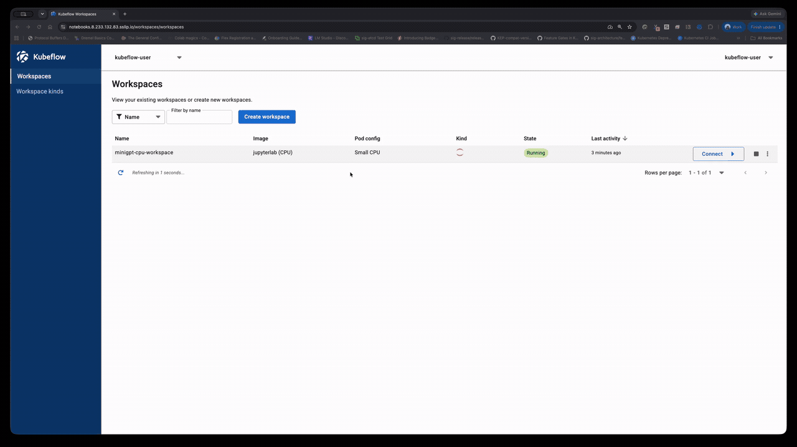
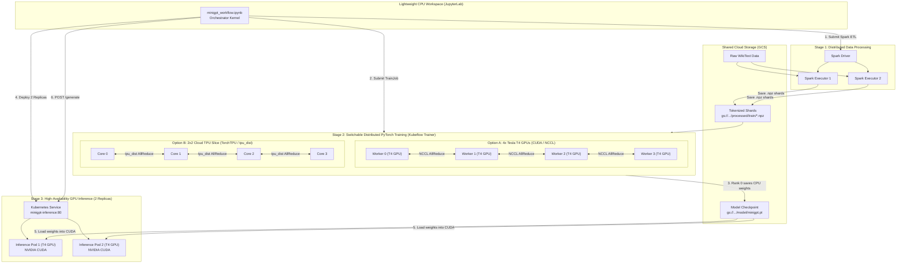

# Distributed MiniGPT Training & Serving on GKE Workspaces

**Audience:** ML engineers and researchers looking to orchestrate an end-to-end LLM lifecycle from a lightweight Jupyter workspace on GKE, scaling seamlessly across Apache Spark for distributed preprocessing, Kubeflow Trainer for multi-GPU and multi-TPU distributed training, and Kubernetes Deployments for multi-replica GPU inference serving.

> [!TIP]
> **Demo Walkthrough:**
>
> 
>
> *A complete video walkthrough demonstrating the workspace as a cluster gateway, switching between 4x Tesla T4 GPUs and 2x2 Cloud TPU v5e with a single parameter, and live node tracking via `kubectl` is available at [`demo_minigpt.mp4`](demo_minigpt.mp4).*

---

## Architecture Flow



---

## What this example demonstrates

1. **Lightweight Orchestration**: The interactive notebook runs inside a standard, cost-efficient **CPU workspace** (`jupyterlab-cpu`, `medium_cpu`), avoiding expensive idle GPU/TPU charges while you develop and orchestrate.
2. **Distributed Data Processing with Apache Spark**: Uses the `kubeflow.spark` SDK to launch ephemeral Spark clusters on Kubernetes that clean, tokenize (GPT-2 tokenizer), and chunk text into training shards directly in GCS.
3. **Switchable Distributed PyTorch Training (`Kubeflow Trainer`)**:
   Switch between two different distributed hardware topologies with a single parameter in the notebook:
   - **`ACCELERATOR = "gpu"`**: 4x NVIDIA Tesla T4 GPUs across 4 worker nodes using PyTorch DDP (`backend="nccl"`) on `gpu-t4-spot`.
   - **`ACCELERATOR = "tpu"`**: 2x2 Cloud TPU v5e slice (4 TPU chips on 1 host) using TorchTPU (`backend="tpu_dist"`) on `tpu-v5-4-single-host`.
4. **Cross-Hardware Model Weight Portability (TPU $\rightarrow$ GPU)**:
   Proves that weights trained on Cloud TPU with `torch_tpu` can be seamlessly loaded into CUDA GPU memory on NVIDIA hardware for production inference.
5. **High-Availability GPU Serving**:
   Deploys a **2-replica GPU inference service** on Tesla T4 hardware that loads the checkpoint from GCS and serves HTTP text generation requests with automatic load balancing.

---

## Hardware Comparison

| Feature | Option A: NVIDIA Tesla T4 GPU | Option B: Cloud TPU v5e |
| :--- | :--- | :--- |
| **Topology** | 4 nodes × 1 T4 GPU | 1 host × 4 TPU chips (2x2 slice) |
| **ComputeClass** | `gpu-t4-spot` | `tpu-v5-4-single-host` |
| **PyTorch Backend** | `nccl` (NVIDIA Collective Communications) | `tpu_dist` (TorchTPU PJRT Interconnect) |
| **Precision** | `torch.float32` | `torch.bfloat16` |
| **Container Image** | `jupyterlab:latest-gpu` | `jupyterlab:latest-tpu` |
| **Command** | `torchrun --nproc_per_node=1 /workspace/train.py` | `torchrun --nproc_per_node=4 /workspace/train.py` |
| **Verified Training Time** | **637.54 seconds** (2 epochs, 3,308 steps) | **147.99 seconds** (2 epochs, 3,308 steps) |
| **Peak Throughput** | **~85,000 tokens/sec** | **~366,000 tokens/sec** |
| **Final Train Loss** | **4.5844** | **5.0996** |
| **Held-out Eval Loss** | **6.3188** (Perplexity: 554.92) | **7.0312** (Perplexity: 1131.39) |
| **Serving Usability** | Loads directly into CUDA on Tesla T4 | Loads directly into CUDA on Tesla T4 |

---

## Prerequisites

Work through this checklist before launching the notebook:

```bash
export PROJECT_ID="$(gcloud config get-value project)"
export CLUSTER_NAME="kubeflow-notebooks"
export LOCATION="us-west1"
export REGION="us-west1"
export TENANT_NAMESPACE="kubeflow-user"
export GCS_BUCKET="${PROJECT_ID}-${TENANT_NAMESPACE}-bucket"

# Optional: REGISTRY defaults to prebuilt public images (ghcr.io/gke-labs/workspaces)
# export REGISTRY="${REGION}-docker.pkg.dev/${PROJECT_ID}/${REPO_NAME}"
```

1. **Verify ComputeClasses**:
   ```bash
   kubectl get computeclass gpu-t4-spot tpu-v5-4-single-host
   ```
2. **Verify Spark Operator & Kubeflow Trainer**:
   ```bash
   kubectl get pods -n kubeflow -l app.kubernetes.io/name=spark-operator
   kubectl get pods -n kubeflow-system -l app.kubernetes.io/name=trainer
   ```

---

## Step 1: Create a CPU Workspace

In the Kubeflow Workspaces UI (`https://${WORKSPACES_HOST}/workspaces/`):

1. Click **Create Workspace**.
2. Configure options:
   - **Name**: `minigpt-workspace`
   - **WorkspaceKind**: `jupyterlab`
   - **Image**: `jupyterlab (CPU)` (`jupyterlab-cpu`)
   - **Pod Config**: `Medium CPU` (`medium_cpu`) or `Small CPU` (`small_cpu`)
3. Click **Create**. Because it requests standard CPU nodes, it starts in seconds.

---

## Step 2: Open and Run `minigpt_workflow.ipynb`

Inside JupyterLab:
1. Open [`minigpt_workflow.ipynb`](minigpt_workflow.ipynb).
2. Run **Stage 0 (Setup)**:
   Verifies in-cluster RBAC permissions for submitting Spark applications, TrainJobs, and Deployments.
3. Run **Stage 1 (Spark ETL)**:
   Connects to Spark via `kubeflow.spark.SparkClient`, launching distributed executor pods that download raw WikiText, tokenize tokens with the GPT-2 tokenizer, and upload chunked `.npz` shards to `gs://${GCS_BUCKET}/processed/train/`.
4. Run **Stage 2 (Distributed Training)**:
   Toggle the target accelerator:
   ```python
   ACCELERATOR = "tpu"  # or "gpu"
   ```
   Kubeflow Trainer provisions the selected hardware and launches PyTorch DDP.
5. Run **Stage 3 (Inspect Checkpoints)**:
   Verifies that `minigpt.pt`, `config.json`, and `metrics.json` were saved to GCS.
6. Run **Stage 4 (Deploy 2-Replica GPU Inference)**:
   Deploys a Kubernetes Deployment with 2 replicas on Tesla T4 GPUs (`nodeSelector: gpu-t4-spot`).
7. Run **Stage 5 (Test Inference)**:
   Queries the service via HTTP POST `/generate` and prints generated text from the 2 GPU replicas.

---

## Cost & Cleanup

To release billable GPU and TPU resources:

```bash
kubectl delete deployment minigpt-inference -n "${TENANT_NAMESPACE}"
kubectl delete service minigpt-inference -n "${TENANT_NAMESPACE}"
kubectl delete trainjob -n "${TENANT_NAMESPACE}" -l app.kubernetes.io/part-of=minigpt-scaling-demo --ignore-not-found
```

GKE Node Auto-Provisioning automatically deprovisions idle GPU and TPU node pools within a few minutes once no pods request them.
